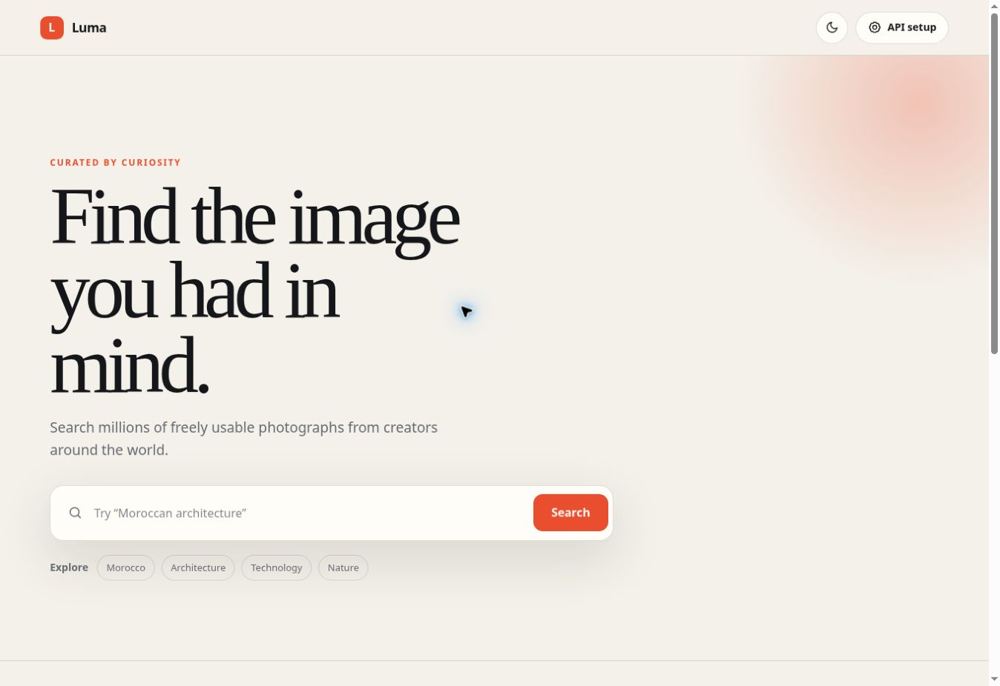

<div align="center">

# Luma

### A refined Unsplash discovery experience

[](https://github.com/deleted04user/LUMA/actions/workflows/quality.yml)

Search photographs through a responsive, accessible interface built with plain HTML, CSS, and JavaScript.



</div>

## Project type

LUMA is a **frontend static web application** written in HTML, CSS, and browser JavaScript. It is not an infrastructure library or a backend API. Optional Docker Compose and Kubernetes manifests deploy the same static frontend. Photo search runs in the browser against Unsplash; no database, server-side application credentials, or backing services are required.

See [architecture](docs/ARCHITECTURE.md) and [deployment and operations](docs/DEPLOYMENT.md) for the application boundaries and the tested hosting options.

## Features

- Live Unsplash search with orientation filters, relevant/latest sorting, and pagination
- Loading skeletons, empty results, and useful authentication, network, and rate-limit errors
- Retryable pagination that preserves existing photos after a failed request
- Cancellation and stale-response protection when searches or filters change
- Saved dark/light themes, accessible controls, and reduced-motion support
- Responsive images, photographer attribution, referral links, and download-event tracking
- Browser-local Access Key setup, with a temporary fallback when storage is blocked
- No production dependencies or framework; optional static build for deployment

[Open the GitHub Pages demo](https://deleted04user.github.io/LUMA/). Changes in an unmerged pull request are not deployed there.

## Getting started

Install **Node.js 24.15 or later in the 24 LTS series**, or Node.js 26 or later. The checked-in lockfile pins development tools; use `npm ci` for reproducible installs.

```sh
git clone https://github.com/deleted04user/LUMA.git
cd LUMA
npm ci
npm start
```

Open `http://127.0.0.1:8000`, choose **API setup**, and enter an **Access Key** from [Unsplash Developers](https://unsplash.com/developers). Never enter a Secret Key. Searches need a valid key and an internet connection; automated tests use mocked API responses and need neither.

The source site can also be served by another static HTTP server, such as `python -m http.server 8000`. ES modules require HTTP; opening `index.html` directly as a file is unsupported.

## Configuration

There are three options:

| Option           | Used by               | Setup                                                                                                           |
| ---------------- | --------------------- | --------------------------------------------------------------------------------------------------------------- |
| API setup dialog | Source and built site | Saves the key in this browser's local storage. If storage is blocked, the key works for the current tab.        |
| `config.js`      | Source site           | Copy `config.example.js` to `config.js` and enter the Access Key. The file is ignored by Git.                   |
| `.env`           | `npm run build`       | Copy `.env.example` to `.env`, set `UNSPLASH_ACCESS_KEY`, then build. The key is written into `dist/config.js`. |

Browsers do **not** read `.env` files. The optional build reads `.env`; `npm start` does not. Without build configuration, the built site asks visitors to supply their own key. Local `config.js` is never copied into the build.

`.env.example` also documents `PORT` and `CI`. `PORT` defaults to 8000 and is read from the server's process environment by `npm start`/`npm run preview`. Compose reads it from `.env` to choose the published host port. `CI` is normally set by GitHub Actions and controls browser-test worker/guard settings; Playwright does not load `.env` automatically. For a local port override, use `PORT=8123 npm start` on macOS/Linux or `$env:PORT='8123'; npm start` in PowerShell, then open port 8123. Command-line `--port=8123` takes precedence over `PORT`.

A key explicitly saved through the dialog applies immediately in the current tab. On a later reload, a nonempty `config.js` key takes precedence over a stored key. Removing the saved key leaves any configured key active; clear local configuration as well to remove it completely.

An Unsplash Access Key is a public client identifier: a key embedded in a deployed frontend is visible to visitors. Never put a Secret Key in client files, `.env`, or a public build. The dev server only serves an explicit list of public assets and does not serve `.env`, Git data, or development files.

## Build and preview

```sh
npm run build
npm run preview
```

The build creates `dist/` from an explicit public-file list and generates `dist/config.js`. Deploy the **contents of `dist/`** to any static host. The source also remains compatible with GitHub Pages project paths because module and asset URLs are relative.

## Verification

```sh
npm test                 # Unit, DOM, build, server, deployment tests and coverage gates
npm run typecheck        # Strict JSDoc checks for browser modules and entry script
npm run check            # Lint, types, formatting, tests, and deployment policies
npm run build
npx playwright install chromium firefox
npm run test:e2e         # Built site: desktop/mobile Chromium and desktop Firefox
npm audit --audit-level=high
```

Linux may also need browser system libraries: use `npx playwright install --with-deps chromium firefox`.

The coverage gate requires at least **90% of lines, 85% of branches, and 90% of functions** across `src/`. Browser tests cover the entry script and the complete UI flow, including key setup, search, filters, pagination retries, error recovery, themes, denied storage, and download tracking. API calls and photo images are mocked so tests do not consume an Unsplash quota. These tests validate client behavior; they do not certify live API availability.

For a Chromium-only local check, use `npm run test:e2e -- --project=desktop-chromium --project=mobile-chromium`. The full suite remains required in CI. Browser failure screenshots, traces, and reports are retained as CI artifacts.

CI exposes separate lint, typecheck, test/coverage, formatting, deployment-policy, build, and audit steps on Linux and Windows. It runs all browser projects, starts the restricted Compose service, and deploys the manifests into a temporary kind cluster to test rollout and HTTP traffic. These checks do not publish to a production host. Dependabot checks npm tools, GitHub Actions, and Docker base images weekly.

## Container

With Docker and Compose running:

```sh
docker compose up --build --wait
```

Open `http://127.0.0.1:8000` and configure a key through **API setup**. `docker compose down` stops the service. The build stage installs locked development tools and runs quality checks. The final image runs as a non-root user with a read-only filesystem and restricted capabilities. `/healthz` verifies that the public assets are present and readable. `.env` and local `config.js` are excluded from the Docker build context.

The optional [Kubernetes deployment](docs/DEPLOYMENT.md#local-kubernetes-deployment) provides two replicas, resource limits, probes, restricted pod security, service wiring, and a network policy. The operations guide explains deployment, port forwarding, logs, rollback, teardown, and the network-policy enforcement requirement.

## Project structure

```text
LUMA/
  index.html, style.css    Semantic interface and responsive styles
  script.js               DOM event wiring and module composition
  src/api.js              Authenticated API calls and structured results
  src/config.js           Key validation and safe storage access
  src/dom.js              Checked DOM element lookup
  src/types.d.ts          Contracts checked against the browser JavaScript
  src/search.js           Search state, cancellation, pagination, and retries
  src/render.js           Safe photo cards, statuses, and loading UI
  src/settings.js         Key dialog, theme preferences, and notifications
  tools/                  Static build and public-file-only dev server
  docker-compose.yml      Health-checked local container deployment
  k8s/base/               Optional Kustomize deployment
  tests/*.test.mjs         Unit, DOM, structural, server, and build checks
  tests/browser/          End-to-end tests against dist/
  .github/workflows/      Cross-platform quality, browsers, and container checks
```

## Accessibility and API behavior

Controls have accessible names, focus indicators, semantic form labels, and live status announcements. Photo metadata is inserted as text, with descriptive alternative text and safe external links. Images use Unsplash URLs, responsive sources, lazy loading, and preserved aspect ratios.

Search uses `Authorization: Client-ID`, strict content filtering, and API version `v1`. Attribution links include Unsplash referral parameters. Download tracking accepts only HTTPS `api.unsplash.com/photos/:id/download` endpoints and refuses redirects so the Access Key is not forwarded elsewhere. Tracking failures produce a notification while the photo link remains available.

Review [Unsplash's API documentation](https://unsplash.com/documentation) and guidelines when deploying a production application.

## Contributing and history

See [CONTRIBUTING.md](CONTRIBUTING.md) for the validation workflow and [CHANGELOG.md](CHANGELOG.md) for changes. Keep real fixes and the tests proving them together in focused commits. Sustained maintenance and collaboration require actual work over time; this tooling cannot guarantee an assessment score or payout.

## Credits and license

Photography and search data are provided by [Unsplash](https://unsplash.com/?utm_source=luma_search&utm_medium=referral). Luma is an educational frontend project and is not affiliated with Unsplash.

Released under the [MIT License](LICENSE).
