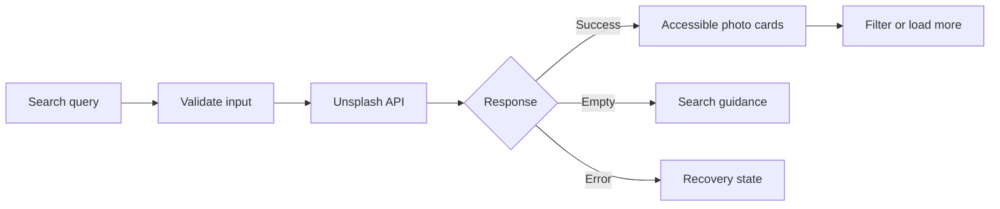

<div align="center">

# Luma

### A refined Unsplash discovery experience


[](https://github.com/deleted04user/LUMA/actions/workflows/quality.yml)

Search millions of photographs through a fast, responsive, and accessible interface powered by the Unsplash API.

</div>

---

## Overview

Luma is a front-end image discovery application built with plain HTML, CSS, and JavaScript. It focuses on a polished search experience without requiring a framework or build step.

The project began as a simple classroom image-search exercise and has been rebuilt with production-minded interface patterns, stronger accessibility, safer configuration, and correct Unsplash attribution.

## Features

- Live Unsplash photo search
- Responsive editorial gallery
- Landscape, portrait, and square filters
- Relevant and latest sorting
- Progressive “load more” pagination
- Loading skeletons
- Empty, error, and rate-limit states
- Dark and light themes with saved preference
- Search suggestions
- Photographer attribution and Unsplash referral links
- Download-event tracking for API compliance
- Responsive images, lazy loading, and preserved aspect ratios
- Keyboard-friendly controls and reduced-motion support
- Browser-local Access Key configuration

## Preview

[Open the live GitHub Pages demo](https://deleted04user.github.io/LUMA/). The search interface asks for an Unsplash Access Key the first time it needs live results; the key stays in the browser.

## Getting Started

### 1. Clone the repository

```bash
git clone https://github.com/deleted04user/LUMA.git
cd LUMA
```

### 2. Start a local server

With Python:

```bash
python -m http.server 8000
```

Then open `http://localhost:8000`.

### 3. Connect Unsplash

Create a free application at [Unsplash Developers](https://unsplash.com/developers), copy its **Access Key**, and add it through the application’s **API setup** dialog.

The key is saved only in your browser’s local storage. Never enter or commit an Unsplash Secret Key.

For local development, you can alternatively copy the configuration template:

```bash
cp config.example.js config.js
```

Then add your Access Key to `config.js`. This file is ignored by Git.

## Project Structure

```text
LUMA/
├── assets/favicon.svg # Project favicon
├── index.html          # Semantic application structure
├── style.css           # Responsive visual system and states
├── script.js           # Search, filters, rendering, and settings
├── config.example.js   # Optional local configuration template
├── tests/smoke.mjs     # Dependency-free structural smoke checks
├── LICENSE
├── .gitignore
└── README.md
```

## Search Flow



## Accessibility

- Semantic headings, forms, navigation, and result regions
- Visible keyboard focus indicators
- Accessible names for icon-only actions
- Meaningful image alternative text from Unsplash metadata
- Screen-reader announcements for changing results
- Touch-friendly controls
- Responsive layouts at mobile, tablet, and desktop widths
- Motion reduction through `prefers-reduced-motion`

## API Compliance

The implementation uses image URLs returned by Unsplash, links photographers and images back to Unsplash with referral parameters, and calls the download-location endpoint when a download is initiated.

Review the latest [Unsplash API Guidelines](https://help.unsplash.com/en/collections/1451694-unsplash-api-guidelines) before deploying a production version.

## Technical Notes

- No framework or package installation is required.
- API requests use the `Authorization: Client-ID` header.
- Search requests use strict content filtering.
- A new search aborts any previous unfinished request.
- User-provided text is rendered through DOM APIs rather than HTML interpolation.
- External links use `noopener noreferrer`.

## Verification

```bash
node --check script.js
node tests/smoke.mjs
```

## Future Improvements

- [ ] Add color filtering
- [ ] Add collections and curated topics
- [ ] Add a fullscreen photo detail dialog
- [ ] Add shareable search URLs
- [ ] Add favorites stored locally
- [x] Add automated structural and secret-safety smoke checks
- [x] Deploy a public demonstration with GitHub Pages
- [ ] Add full automated accessibility and browser tests

## Credits

Photography and search data are provided by [Unsplash](https://unsplash.com/?utm_source=luma_search&utm_medium=referral).

## Disclaimer

This is an educational front-end project and is not affiliated with or endorsed by Unsplash.

## License

Released under the [MIT License](LICENSE).
