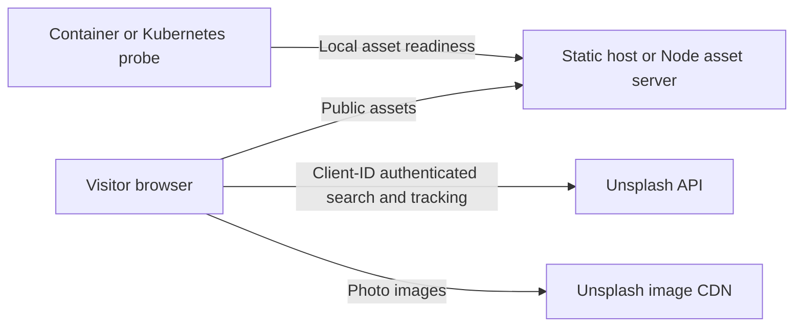

# Architecture

LUMA is a framework-free frontend/static site. Docker Compose and Kubernetes are optional hosting configurations; they do not turn photo search into a backend service.

## Browser modules

`script.js` composes modules and connects DOM events. `src/dom.js` validates the types and presence of required page controls. `src/config.js` validates configured keys and handles denied browser storage. `src/settings.js` manages the key dialog and theme preferences. `src/api.js` returns discriminated success/error results and validates API responses before rendering. `src/search.js` owns search state, filters, pagination, and cancellation. `src/render.js` creates accessible DOM nodes and recovery states.

TypeScript checks the existing JavaScript through JSDoc and `src/types.d.ts`, with strict null and caller-contract checks. It emits no files and adds no browser runtime. The compile-time fixtures exercise success/error narrowing and reject invalid API arguments. Node tests exercise the modules with mock requests and jsdom; Playwright covers their integration through the built site.

## State and failure behavior

Each new search aborts the previous request and advances a revision counter. Only the current revision may update state, including errors and loading state, even when a transport ignores abort. A page number is committed only after a successful response. Failed pagination preserves the already displayed photos and retries the same next page. Repeated clicks while loading do not start duplicate page requests.

API results distinguish missing keys, unauthorized keys, rate limits, invalid responses, cancellation, network failures, HTTP failures, and invalid tracking URLs. Malformed photo data never reaches card rendering. Metadata is inserted as text. Download tracking authenticates only HTTPS Unsplash endpoints and refuses redirects; a tracking failure is announced without removing the external photo link.

## Configuration and trust boundaries

A visitor's Access Key stays in browser storage, or in memory for the tab when storage is blocked. It is sent directly to Unsplash, not to the asset server. A configured build key is an intentionally public client identifier visible in the generated JavaScript. No Secret Key belongs in this project. The site has no server-side user sessions, database, secret store, or quota proxy.

The static build uses an explicit file list and excludes local configuration, `.env`, tests, and development files. The Node server serves the same public allowlist, plus a credential-free asset health endpoint. Request logs record only public resource categories, method, response status, and duration. The optional deployment's security headers and Kubernetes/Compose restrictions are described in [DEPLOYMENT.md](DEPLOYMENT.md).

## Validation boundaries

Coverage thresholds apply to browser app modules. Tooling and deployment behavior also have functional and policy tests. CI validates both operating systems, browser flows, a running read-only container, and a real Kubernetes rollout. Automated photo/API responses are mocked; live Unsplash availability and a particular visitor's key are external dependencies. Kubernetes network-policy enforcement depends on the cluster CNI and is not demonstrated by the default kind network.
